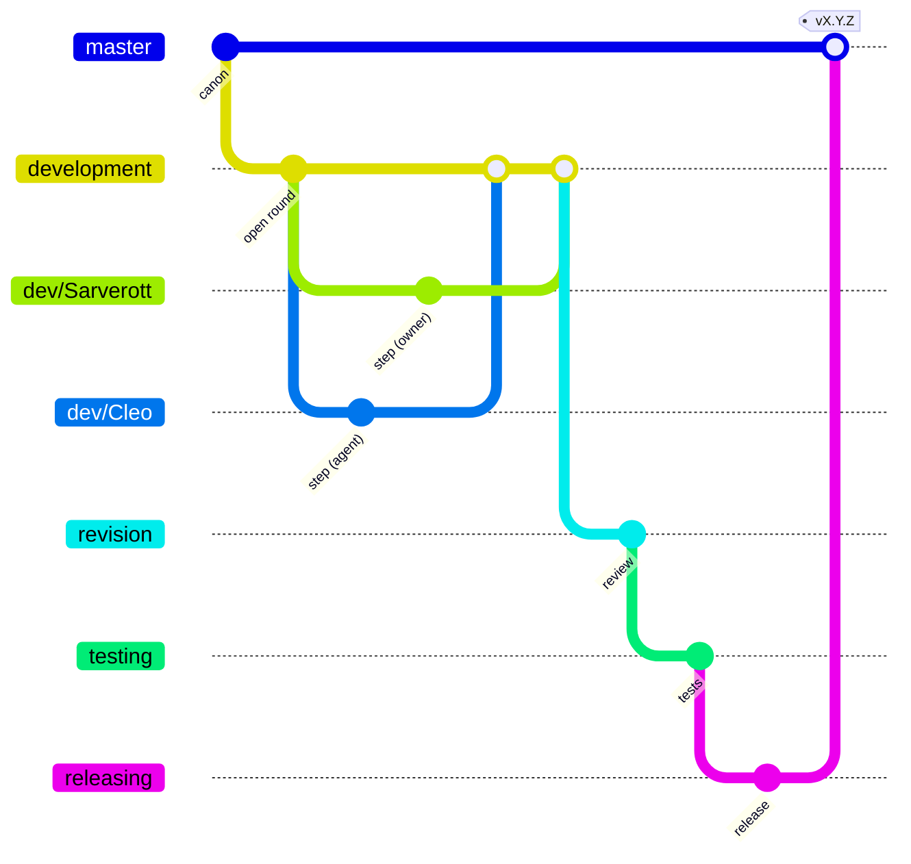

# AGENTS.md: blacksmith-organization-system (core)

Guide for AI agents (Claude Code, Codex, Gemini CLI, Copilot, Cursor, Aider…)
and for people working the same way **on this repository**. It complements the
workshop-wide `__WORKSHOP/AGENTS.md`; where they differ, this file wins here.
Keep it current when something changes.

## What this repository is

The **core** of the Blacksmith Organization System (BOS), a TypeScript module:
it builds the base of a workshop, listens to its changes, inspects it as one
coherent environment, and holds the craft loop (branches, steps, phases,
versions) every BOS project follows.

```
~/__WORKSHOP/forge/blacksmith-organization-system/   scope: family of BOS repositories
├── blacksmith-organization-system/   ← this repo: the core (github: Sarverott/blacksmith-organization-system, npm: blacksmith-organization-system)
└── bos-skillset/                     skills, Claude Code plugin, MCP (github: Sarverott/bos-skillset); will build on the core
```

The legacy CommonJS core (v0.6.1) is the tag `legacy/v0.6.1`; its shell
scripts are in `scripts/` as sketches of procedures still to be coded.

## Read first

1. `docs/devlog/README.md`: what each devlog file is and how a batch of the
   owner's orders moves. Then `VISION.md`, `ROADMAP.md`, `TODO.md`.
2. `docs/devlog/BRAINSTORM.md`: open questions `Q<n>`; never settle one in code.
3. `docs/devlog/ORDERS.md`, `INQUIRIES.md`: if anything is written below their
   `---`, it is the owner's and comes first (see "Taking in" below).
4. `docs/changelog/`: how it got here, the owner's words verbatim.
5. `docs/.agents/`: what agents found and concluded (`NOTES.md`, `CLEO.md`).
6. `docs/glossary/`: one page per element. Meaning before code: write or
   change the page first, then the model.

`task devlog:state` (or `node src/cli.ts devlog state`) shows where it all stands.

## The development workshop

The core is run, tried and demonstrated on its own workshop, never the home
one. `.env` (from `.env.example`, not committed) sets `WORKSHOP_ROOT`, now
`/run/media/sarverott/setternet-A62/` → `/run/media/sarverott/setternet-A62/__WORKSHOP`;
the CLI of this checkout reads it wherever it is started. Check with
`node src/cli.ts workshop locate` (it must say `found by: $WORKSHOP_ROOT`)
before running anything that writes. Without a `.env`, ask the owner instead
of falling back on `~/__WORKSHOP`.

## Architecture

```
src/
├── bos.ts         spine: class BOS(host, options) - workshop, bootstrap(), inspect(), watch(), bumpScope()…;
│                  every model as BOS.<Model> (new BOS.Craftbook(host, path))
├── core/          host.ts (the one door to the machine), element.ts (anatomy: dirname, children,
│                  descriptors → ensure + inspect; an Emitter: "created"), emitter.ts (on/once/off/emit),
│                  procedure.ts (named steps, trace), context.ts (createIfMissing), tool.ts (one tool
│                  format), version.ts (semver + GRIH), paths.ts (+ packagePath), json-file.ts, serialize.ts,
│                  omnis.ts (.omnis.toml) + ignore.ts (.gitignore read by BOS), ruling.ts + patterning.ts (the
│                  almanac: rules judged, chains recalled), daemon.ts (services, contexts, restart policy)
├── hosts/         NodeHost (+ watch-tree.ts): the only files that touch node:* (fs, os, child_process);
│                  daemon/: the supervisor of a daemon (child processes, signals, monitor threads)
├── bridges/       a folder per kind of outside system, every bridge a Bridge (base.ts: its command through
│                  Host.run); git-integration/: Git → LocalGit, RemoteGit → GitHub, Gitea, GitLab…
├── models/        <model>/class.ts: the glossary as classes (workshop, system = .BOS and its parts,
│                  devarmory, forge, scope, project, craftbook, archive, devlog, loop, settings = .github/bos.json,
│                  almanac = docs/almanac/ + resources/almanac/)
├── procedures/    <name>/DESCRIPTION.md + one file per step + _index.ts (the order):
│                  bootstrapping, inspecting (rules.ts: one function per finding), watching, versioning,
│                  proposing + automerging (the craft loop on GitHub: bos flow next-pr / automerge),
│                  bumping (the project's version per station: bos flow bump), sealing (.bos/.omnis.toml),
│                  judging + recalling (the almanac: bos almanac judge / recall), archiving (bos archive
│                  mirror), daemonizing (bos daemon start / stop…: ollama serve and other daemons)
├── tools/         <model>.ts: what `bos <model> <tool>` runs; _index.ts collects them
├── views/         text for people (status tree, event line, help, STATE.md)
├── cli.ts         bos <model> <tool> [operands] [--flags]; --json, --workshop=
└── index.ts       library entry
tests/             vitest, one file per concern; helpers.ts makes temporary workshops
Dockerfile         the bos command as a container image (the publish workflows; phase 3: workplaces)
scripts/           workflows/ (the steps of .github/workflows, task workflows:<name>), gh-wiki.py (docs → GitHub wiki),
                   devtools/ (ollama-serve.sh: bos daemon … ollama), legacy shell sketches still to port (reference only)
docs/              devlog, changelog, .agents, glossary; MkDocs site (docs/mkdocs.yml, Read the Docs)
```

Source runs as is on Node ≥ 22.18 (type stripping): only erasable TypeScript
(no enums, no parameter properties, no namespaces), imports name the `.ts`
file. `npm run build` emits `dist/` for the package.

## Commands

```sh
task check          # tsc + biome + vitest (= CI, = the pre-commit hook)
task test -- <name> # some tests
task format         # biome fixes
task commit         # commitizen
task docs:build     # MkDocs --strict
task devlog:state   # docs/devlog/STATE.md
task workflows:<name> -- <args>   # a step of the GitHub workflows (scripts/workflows/)
task status | bootstrap | watch   # the core on the active workshop
```

## The craft loop

### Branches



- `master`: spine of canon. Never commit or push to it directly; it moves only
  through a pull request from `releasing`.
- `development`: the merged accumulation of every contributor's `dev/<name>`
  branch (decision Q1: formerly misspelt `developement`).
- `dev/<name>`: one per contributor, human or agent: `dev/Sarverott`,
  `dev/Cleo` (Claude Code), `dev/<codex-name>`… An agent works **only** on its
  own `dev/<name>` branch and merges it into `development` when a batch is done.
- `revision` → `testing` → `releasing` → `master`; a stage that fails goes to
  `rejection`, which returns to `development` (from gitrecon). The loop is
  data (`src/models/loop/data.ts`, a project's own `.github/bos.json`);
  `bos flow explain` shows it, `bos flow next-pr` / `automerge` move it on
  GitHub (phase 2: the workflows that call them are next).

### Steps, phases, milestones, versions

| Event | Project (semver `vX.Y.Z`) | Scope (GRIH `vG.R.I.H`) |
| ----- | ------------------------- | ----------------------- |
| step: one finished, checked piece of work, one commit | Z | H |
| phase: every item of a TODO.md phase ticked | Y | I |
| milestone | X | R |
| the script flips: pre-alpha → alpha, a key concept changes | X | G |

`core/version.ts` computes them; a scope keeps its version in
`<scope>/.bos/scope.json` (decision Q5). The project's version follows the
routine (phase 2): **every commit on `dev/<name>` bumps Z** by itself (the
pre-commit hook stages `package.json` and its lock with the commit),
`revision` bumps Y, a hotfix on `master` Z; when two branches meet, the
version merges by the higher one (`.gitattributes`, `task
hooks:merge-driver`). Wiring the bumps to TODO.md phases is still to come.

## The routine

How a batch ends (phase 2: the short way `revision → master`; the full
loop through `revision → testing → releasing` comes later):

1. Every step is a commit on the agent's `dev/<name>`; checked steps may be
   merged and pushed to `origin/development` at any time.
2. When the agent stops and needs the owner: merge `dev/<name>` into
   `development` (`--no-ff`), push it, and push `development` to
   `revision`. The agent opens no pull request; the release `nightly`
   follows `revision`.
3. On GitHub, `loop-revision-bump-checks-pull-request.yml` runs every check,
   names new entities in `.github/AUTHORS`, bumps the minor version if the
   current one is released already, pushes what it committed to `revision`
   and `development` - **pull `development` before the next batch** - and
   opens the pull request `revision → master` (an open one follows). The
   owner merges it; `loop-master-release-and-publish.yml` tags, makes the
   GitHub release, publishes (npm, GitHub Packages, container images for a
   full release), syncs the docs, calls the webhooks and merges `master`
   back into `development`.

Settings of all this: `.github/bos.json` (`loop`, `versioning`); `bos flow
explain` shows them.

## Taking in a batch of the owner

In this order:

1. **The owner's edits** in the working tree go to `dev/Sarverott`, as they
   are, **one commit per change**. The agent writes each message
   (conventional, commitlint-checked): what changed, and in the body how the
   agent understands it - what it is, why it is where it is, the assumptions
   made - ending with the agent's `Co-Authored-By:` line. The owner reads
   there whether the agent understood. `dev/Sarverott` is then merged into
   `development` (`--no-ff`), like the agent's own `dev/<name>`.
2. **ORDERS.md** (on the agent's branch, as everything below): the answers move word for word into
   `docs/changelog/phase-<n>.md` with the questions and a **Decision:** each;
   the answered `Q<n>` leave BRAINSTORM.md; ORDERS.md keeps only its header.
3. **INQUIRIES.md**: first the plan (VISION, ROADMAP, TODO), the words
   verbatim into the changelog, then the work; INQUIRIES.md keeps its header.

## Where things go

| It is | It goes to |
| ----- | ---------- |
| the owner's words | `docs/devlog/ORDERS.md` / `INQUIRIES.md`, then the changelog, verbatim |
| a plan | `docs/devlog/VISION.md`, `ROADMAP.md`, `TODO.md` |
| a question for the owner | `docs/devlog/BRAINSTORM.md` as `## Q<n>. <title>` with a *Lean:* |
| an agent's idea for debate | `docs/devlog/PROPOSALS.md` as `PP<n>` |
| what happened, per phase | `docs/changelog/phase-<n>.md`, append-only, sections `## UNIXUSAT=<ms> · commit <hash>` |
| an agent's findings, assumptions, own view | `docs/.agents/` |
| a definition of an element | `docs/glossary/<element>.md` |
| work for another repository | `~/__WORKSHOP/forge/NOTES-for-repositories.md` (never edit the other repo) |
| a loose note of the owner | `~/__WORKSHOP/craftbook/scrapnotes/` |
| a rule of the environment, as data | `resources/almanac/rulesets/` (every project), `docs/almanac/rulesets/` (this one) |
| a situation solved, as a chain of events | `resources/almanac/patterning/` (every project), `docs/almanac/patterning/` (this one) |

## `docs/.agents/`: the agents' own space

Agents write here; people only read it. Each agent keeps its own file
(`CLEO.md` for Claude Code) plus the shared `NOTES.md` (findings, newest on
top, dated). People answer in `docs/devlog/`, not here.

## Rules

These rules are also data: `resources/almanac/rulesets/bos-environment.json`.
`bos almanac judge "<what you are about to do>"` says whether a case breaks
one (`ALLOWED`, `ASK FIRST`, `VIOLATION`, or `UNKNOWN`: ask). When a rule
changes here, change it there too, and the other way round.

1. **Contributors committee.** Every agent and every person is a member: same
   loop, same checks, own branch, own name.
2. **Re-check before acting.** The owner works in parallel. Run `git status`
   first; anything you didn't make is the owner's: treat it as intended and
   never revert or overwrite it.
3. **Commits.** Conventional commits (`type(scope): subject`), checked by
   commitlint in the `commit-msg` hook. One commit per finished step, ticking
   its TODO item. An agent's commits end with its `Co-Authored-By:` line.
   Never `--no-verify`; chain a commit after checks with `&&`.
4. **Code is the procedure.** A new behaviour is a procedure directory: a
   `DESCRIPTION.md` (why), one file per step (how), `_index.ts` (the order).
   A new finding of `bos workshop status` is one function in
   `procedures/inspecting/rules.ts`.
5. **Small files, one concern each**, collected by the nearest index: `index.ts` when it
   stands alone in its directory (`models/`, `procedures/`), `_index.ts` among sibling
   files (a procedure's steps, `tools/`), so it sorts first.
6. **BOS creates only what is missing.** Every write goes through
   `createIfMissing` or an explicit, dry-run-aware step; a dry run plans
   exactly what the real run does.
7. **One door to the machine.** Only `hosts/` imports `node:*` (and `cli.ts`
   to start). Outside systems (GitHub, git, Gitea, docker…) are reached only
   by their bridge in `src/bridges/`, which runs their command line through
   `Host.run`; tests script that `run`.
8. **Test against a temporary workshop** (`tests/helpers.ts`), try things by
   hand on the development workshop (`.env`), never on the home
   `~/__WORKSHOP` unless the owner asks. A fixed bug gets a test.
9. **Unknowns are `[TODO]`.** Don't invent meanings; mark interpretations
   *(assumed)*; open questions go to BRAINSTORM.md.
10. **Push freely, ask the rest.** An agent pushes `development`, its own
    `dev/<name>` and `revision` without asking (decision of the owner, phase
    2). Anything else - `master`, `testing`, `releasing`, tags, releases,
    publishing (npm, the wiki's repository), remotes, repository settings -
    is asked for first, with the reason.
