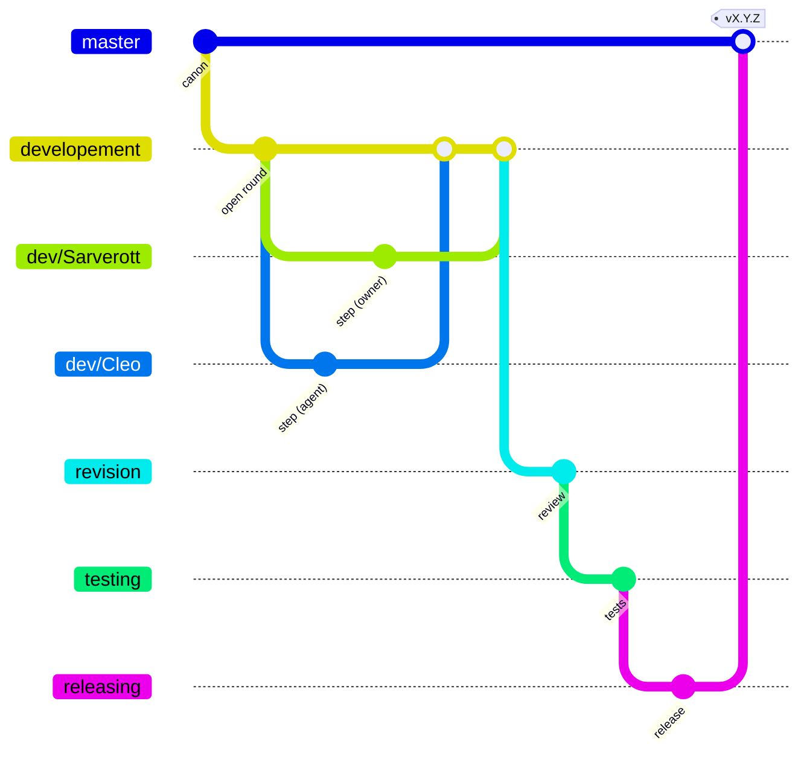

# AGENTS.md: blacksmith-organization-system (core)

Guide for AI agents (Claude Code, Codex, Gemini CLI, Copilot, Cursor, Aider…)
and for people working the same way **on this repository**. It complements the
workshop-wide `__WORKSHOP/AGENTS.md`; where they differ, this file wins here.
Keep it current when something changes.

## What this repository is

The **core** of the Blacksmith Organization System (BOS): the code that defines
the workshop's elements, the procedures run on them, and the craft loop
(branches, phases, steps, versions) every BOS project follows.

```
~/__WORKSHOP/forge/blacksmith-organization-system/   scope: family of BOS repositories
├── blacksmith-organization-system/   ← this repo: the core (origin: Sarverott/OLD-VERSIONS_blacksmith-organization-system, [`TODO`] rename)
└── bos-skillset/                     skills, Claude Code plugin ("the suit"), MCP; consumes the core
```

Direction (owner's decision, 2026-11-05): the core is built **here first**;
`bos-skillset` then uses mostly code from here instead of carrying its own.
What lives where after the split is drafted in `docs/.agents/CLEO.md`.

**State now:** `src/` is the legacy CommonJS code (v0.6.1, about 40 unused
dependencies). It is to be **rebuilt**, not extended: simplified, with clear
mechanics, and everything that isn't needed removed. Do not add features to
the legacy files.

## Read first

1. `docs/devlog/DRAFT.md`: the owner's draft, the source of the direction.
2. `docs/.agents/CLEO.md`: conclusions from every source and the rebuild plan.
3. `docs/devlog/BRAINSTORM.md`: open questions `Q<n>`; never settle one in code.
4. `docs/glossary/`: one page per element (workshop, forge, scope, sarcophag…).
   Meaning before code: write or change the page first, then the code.

## Sources to adapt

All of it may be taken, renamed or dropped; nothing has to be kept as it is.

| Source | Path | What to take |
| ------ | ---- | ------------ |
| bos-skillset | `../bos-skillset/` | the spine (`src/main.ts`, `src/core/`), models, procedures, bridges, toolkit (one tool = CLI + MCP + help), husky, biome, commitlint, semantic-release |
| gitrecon | `~/__WORKSHOP/forge/redscope-technologies/gitrecon` | branch loop as data (`.github/bos.config.json`: stages, directions, `rejection`, automerge flags), its engine (`.github/bos/flow.py`) and workflows, hooks that only call Taskfile tasks, routine flags (`.husky/bos.config.json`), `metadata.json` as single source, `scrapnote-<UNIXUSAT>.md` |
| Amoorion | `~/__WORKSHOP/forge/sarverott/github-repos/amoorion` | `docs/.agents/` (GUIDE, MAP, NOTES, CLEO), devlog files (VISION, TODO, BRAINSTORM `Q<n>`, PROPOSALS `PP<n>`, ORDERS, INQUIRIES), append-only `docs/changelog/phase-<n>.md`, step = Z / phase = Y / all phases = X releases (`.github/flow.toml`), pre-release marking after merge back, "everything is a method" |

## The craft loop

### Branches



- `master`: spine of canon. Never commit or push to it directly; it moves only
  through a pull request from `releasing`.
- `developement`: the merged accumulation of every contributor's `dev/<name>`
  branch (the name keeps its historical spelling; see `Q1`).
- `dev/<name>`: one per contributor, human or agent: `dev/Sarverott`,
  `dev/Cleo` (Claude Code), `dev/<codex-name>`… An agent works **only** on its
  own `dev/<name>` branch.
- `revision` → `testing` → `releasing` → `master`; a stage that fails goes to
  `rejection`, which returns to `developement` *(from gitrecon; not yet here)*.

### Steps, phases, milestones, versions

| Event | Project (semver `vX.Y.Z`) | Scope (GRIH `vG.R.I.H`) |
| ----- | ------------------------- | ----------------------- |
| step: one finished, checked piece of work, one commit | Z | H |
| phase: a planned group of steps completed | Y | I |
| milestone | X | R |
| the script flips: pre-alpha → alpha, a key concept changes | X | G |

Every step ends in a commit. Phases and milestones are defined in
`docs/devlog/TODO.md` *(planned)*; how the code detects their completion is
part of the rebuild.

### Tooling (target; being set up)

commitizen (conventional commits, bumps), husky (git hooks that only call
Taskfile tasks), biome.js (lint + format), Taskfile (every procedure and
workmode is a task), GitHub workflows (the loop: open the next PR, check,
merge, bump, tag). Workmodes are sets of tasks with file-change listeners and
git hooks. Each coding agent's host CLI runs in its own container, on its own
`dev/<name>` branch; the owner has one too *(planned, see CLEO.md)*.

## Where things go

| It is | It goes to |
| ----- | ---------- |
| the owner's draft, plan, orders | `docs/devlog/` (DRAFT, VISION, TODO, ORDERS, INQUIRIES) |
| a question for the owner | `docs/devlog/BRAINSTORM.md` as `Q<n>` with a *Lean:* |
| an agent's idea for debate | `docs/devlog/PROPOSALS.md` as `PP<n>` |
| what happened, per phase | `docs/changelog/phase-<n>.md`, append-only, sections start with `UNIXUSAT=<ms> · commit <hash>` |
| an agent's findings, assumptions, own view | `docs/.agents/` |
| a definition of an element | `docs/glossary/<element>.md` |
| work for another repository | `~/__WORKSHOP/forge/NOTES-for-repositories.md` |
| a loose note of the owner | `~/__WORKSHOP/craftbook/scrapnotes/` |

## `docs/.agents/`: the agents' own space

Agents write here; people only read it. Each agent keeps its own file
(`CLEO.md` for Claude Code) plus the shared `NOTES.md` (findings, newest on top,
dated). Agents don't write their notes elsewhere in `docs/`, and people don't
edit `docs/.agents/` (they answer in `docs/devlog/`).

## Rules

1. **Contributors committee.** Every agent and every person is a member of the
   contributors committee: same loop, same checks, own branch, own name.
2. **Re-check before acting.** The owner works in parallel. Run `git status`
   first; anything you didn't make is the owner's: treat it as intended and
   never revert or overwrite it.
3. **Commits.** Conventional commits (`type(scope): subject`); the type decides
   the bump, so choose it honestly. One commit per finished step. An agent's
   commits end with its `Co-Authored-By:` line. Never `--no-verify`.
4. **Code is the procedure.** Every structure and mechanic of BOS is code, not
   only prose: a new behaviour is a procedure step in its own file, collected
   by the nearest `_index`, described in a `DESCRIPTION.md`.
5. **Small files, one concern each.** Revisions by the owner and by agents then
   don't collide, and feedback has an address.
6. **BOS creates only what is missing.** It never overwrites or deletes without
   an explicit, dry-run-aware step.
7. **Outside systems only through bridges** (git, GitHub, Gitea, docker,
   ollama…), nowhere else.
8. **Test against a temporary workshop**, never the real `~/__WORKSHOP`.
9. **Unknowns are `[TODO]`.** Don't invent meanings; mark interpretations
   *(assumed)*; open questions go to BRAINSTORM.md.
10. **Ask first** before pushing, tagging, publishing (npm, GitHub releases),
    renaming remotes or changing repository settings.
