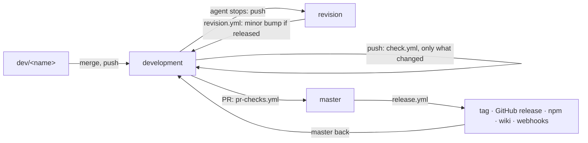

# Workflows

The craft loop on GitHub (`.github/workflows/`). The workflows hold no logic of
their own beyond git and `curl`: what the loop decides is `bos flow` of this
checkout, reading `.github/bos.json`. Decisions Q10, Q11 and the owner's
routine (changelog [phase 2](../changelog/phase-2.md)). Every workflow can also
be started by hand (`workflow_dispatch`).

## The routine, on GitHub

| Workflow | Runs on | Does |
| -------- | ------- | ---- |
| `checks.yml` | called by the others; by hand: all | one job per check: `types`, `lint`, `tests`, `build` (code), `docs` (MkDocs `--strict`), `package` (packs, installs, runs `bos`), `commits` (commitlint over a range) |
| `check.yml` | push to `development`, `dev/**` | only the parts the push touched: code, docs, or both (a new branch: both) |
| `pr-checks.yml` | pull request into a station | every check, the commits of the pull request too; then `bos flow automerge` (a pull request into `master` waits for a person) |
| `revision.yml` | push to `revision` | `bos flow bump revision`: a released version gets the minor; the bump is pushed to `revision` and merged into `development` |
| `release.yml` | push to `master` | checks; `bos flow bump master` (the patch, only for a released version: a hotfix); tag `v<version>` and GitHub release (a pre-release while npm is `next`, Q7); then Discord/Telegram, npm, the wiki, social media; `master` back into `development`; the BOS workshop called |
| `npm-publish.yml` | called by `release.yml`; a GitHub release made by a person | `npm publish --provenance`, `next` for a pre-release |
| `flow.yml` | by hand only | `bos flow next-pr <branch>`: the full loop `revision → testing → releasing → master`, not driven yet |

A push made by a workflow with its own token starts no other workflow, so the
bumps and the merge back into `development` do not loop. After `revision.yml`
or `release.yml` ran, **pull `development`**.

## Secrets

Each outward call runs only when its secret is set (repository settings →
secrets); without it the job says so or does nothing.

| Secret | For |
| ------ | --- |
| `npm_token` | npm automation token: publishing |
| `WIKI_TOKEN` | a token that can push the wiki (else the workflow's own token is tried) |
| `DISCORD_WEBHOOK` | a Discord channel's webhook URL: the dev community |
| `TELEGRAM_BOT_TOKEN`, `TELEGRAM_CHAT_ID` | a Telegram bot and the chat it writes to |
| `SOCIAL_WEBHOOK` | one webhook for social media, receives `{event, repository, tag, url}` ([`TODO`]: which media) |
| `BOS_WORKSHOP_HOOK` | the listening BOS workshop, receives `{event, repository, tag, sync}` ([`TODO`]: BOS has no listener yet) |

Read the Docs needs no secret: it builds on every push by its own webhook.
