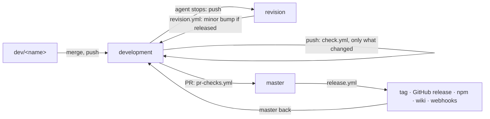

# Workflows

The craft loop on GitHub (`.github/workflows/`). A workflow only says when
and in which order; every step longer than one command is a script in
`scripts/workflows/`, run as `task workflows:<name> -- <arguments>`, so it can
be read and run by hand on its own. What the loop decides is `bos flow` of
this checkout, reading `.github/bos.json`. Decisions Q10, Q11 and the owner's
routine (changelog [phase 2](../changelog/phase-2.md)). Every workflow can also
be started by hand (`workflow_dispatch`).

## The routine, on GitHub

| Workflow | Runs on | Does |
| -------- | ------- | ---- |
| `checks.yml` | called by the others; by hand: all | one job per check: `types`, `lint`, `tests`, `build` (code), `docs` (MkDocs `--strict`), `package` (packs, installs, runs `bos`), `commits` (commitlint over a range) |
| `check.yml` | push to `development`, `dev/**` | only the parts the push touched: code, docs, or both (a new branch: both) |
| `pr-checks.yml` | pull request into a station | every check, the commits of the pull request too; then `bos flow automerge` (a pull request into `master` waits for a person) |
| `revision.yml` | push to `revision` | `bos flow bump revision`: a released version gets the minor; the bump is pushed to `revision` and merged into `development` |
| `release.yml` | push to `master` | checks; `bos flow bump master` (the patch, only for a released version: a hotfix); tag `v<version>` and GitHub release (a pre-release while npm is `next`, Q7); then Discord/Telegram, npm, Read the Docs, the wiki, social media; `master` back into `development`; the BOS workshop called |
| `npm-publish.yml` | called by `release.yml`; a GitHub release made by a person | `npm publish --provenance`, `next` for a pre-release |
| `flow.yml` | by hand only | `bos flow next-pr <branch>`: the full loop `revision → testing → releasing → master`, not driven yet |

A push made by a workflow with its own token starts no other workflow, so the
bumps and the merge back into `development` do not loop. After `revision.yml`
or `release.yml` ran, **pull `development`**.

## Steps

| Task (`scripts/workflows/`) | Does | Used by |
| --------------------------- | ---- | ------- |
| `changes` | which parts a push touched: `code`, `docs` | `check.yml` |
| `commits` | commitlint from a base, never before commitlint came in | `checks.yml` |
| `package` | packs, installs into an empty project, runs `bos` | `checks.yml` |
| `bump` | `bos flow bump <station>`, committed and pushed | `revision.yml`, `release.yml` |
| `merge-into` | a ref merged into a branch, pushed | `revision.yml`, `release.yml` |
| `release` | tag `v<version>` and GitHub release, unless tagged | `release.yml` |
| `publish` | `npm publish --provenance`, unless that version is on npm | `npm-publish.yml` |
| `wiki` | the docs into the GitHub wiki, pushed | `release.yml` |
| `readthedocs` | the tag's version activated and built, `latest` rebuilt | `release.yml` |
| `notify` | `community` (Discord, Telegram), `social`, `workshop` hooks | `release.yml` |

## Secrets

Each outward call runs only when its secret is set; without it the step says
so and does nothing. Publishing secrets live in the environment
**`publish-env`** (repository settings → environments); the jobs that use
them declare it.

| Secret | Where | For |
| ------ | ----- | --- |
| `NPM_TOKEN` | `publish-env` | npm: publishing (`npm-publish.yml`) |
| `READTHEDOCS_API_TOKEN` | `publish-env` | Read the Docs: activate and build the tag's version |
| `DOCKER_HUB_TOKEN` | `publish-env` | [`TODO`] not used yet: a Docker image of BOS (phase 3, workplaces) |
| `SCALAR_API_TOKEN` | `publish-env` | [`TODO`] not used yet: an API reference on Scalar, once BOS has an HTTP API (phase 4) |
| `WIKI_TOKEN` | repository | a token that can push the wiki; without it the workflow's own token is used (it worked for `v1.0.0`) |
| `DISCORD_WEBHOOK` | repository | a Discord channel's webhook URL: the dev community |
| `TELEGRAM_BOT_TOKEN`, `TELEGRAM_CHAT_ID` | repository | a Telegram bot and the chat it writes to |
| `SOCIAL_WEBHOOK` | repository | one webhook for social media, receives `{event, repository, tag, url}` ([`TODO`]: which media) |
| `BOS_WORKSHOP_HOOK` | repository | the listening BOS workshop, receives `{event, repository, tag, sync}` ([`TODO`]: BOS has no listener yet) |

Read the Docs also builds every push by its own webhook, without a secret.
