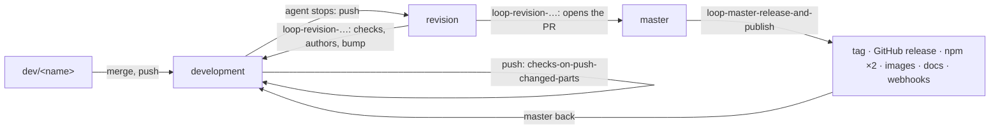

# Workflows

The craft loop on GitHub (`.github/workflows/`). A workflow only says when
and in which order; every step longer than one command is a script in
`scripts/workflows/`, run as `task workflows:<name> -- <arguments>`, so it can
be read and run by hand on its own. What the loop decides is `bos flow` of
this checkout, reading `.github/bos.json`. Decisions Q10, Q11 and the owner's
routine (changelog [phase 2](../changelog/phase-2.md)). Every workflow can also
be started by hand (`workflow_dispatch`).

## Names

A file name says what the workflow is and when it runs; its `name:` says the
same in the Actions tab. Three families (owner's inquiry, phase 2):

- `checks-*`: the checks, and when they run;
- `loop-*`: the craft loop's stations (`revision`, `master`) and the by-hand step;
- `<registry>-<kind>-publish`: one publishing target each.

## The routine, on GitHub

| Workflow | Runs on | Does |
| -------- | ------- | ---- |
| `checks-reusable-set.yml` | called by the others; by hand: all | one job per check: `types`, `lint`, `tests`, `build` (code), `docs` (MkDocs `--strict`), `package` (packs, installs, runs `bos`), `commits` (commitlint over a range) |
| `checks-on-push-changed-parts.yml` | push to `development`, `dev/**` | only the parts the push touched: code, docs, or both (a new branch: both) |
| `checks-on-pull-request-then-automerge.yml` | pull request into a station, opened by a person | every check, the commits of the pull request too; then `bos flow automerge` (a pull request into `master` waits for a person) |
| `loop-revision-bump-checks-pull-request.yml` | push to `revision` | every check (the commits since `master` too); `bos project authors` (`.github/AUTHORS`); `bos flow bump revision` (the minor, once the line `v<X.Y>.*` is released); the release `nightly` moves to `revision` with the package's file; what it committed is pushed to `revision` and merged into `development`; then the pull request `revision → master` is opened (or the open one follows) |
| `loop-master-release-and-publish.yml` | push to `master` | checks; `bos flow bump master` (the patch, only for a released version: a hotfix); tag `v<version>` and GitHub release (a pre-release while npm is `next`, Q7); then Discord/Telegram; the package's file into the release, the release `latest` moved to it, every file of the release to VirusTotal; the publish workflows, Read the Docs, the wiki, social media; `master` back into `development`; the BOS workshop called |
| `npmjs-npm-package-publish.yml` | called by the release; a GitHub release made by a person; by hand | `npm publish --provenance` to npmjs.org, `next` for a pre-release |
| `github-npm-package-publish.yml` | called by the release; by hand | the package on GitHub Packages as `@sarverott/blacksmith-organization-system` (it takes scoped names only), pre-releases under `next` |
| `docker-container-publish.yml` | called by a full release; by hand | the image of the `Dockerfile` on Docker Hub: `<version>`, `<major>.<minor>`, `latest` |
| `github-container-publish.yml` | called by a full release; by hand | the same image on `ghcr.io/sarverott/blacksmith-organization-system` |
| `loop-next-pull-request-by-hand.yml` | by hand only | `bos flow next-pr <branch>`: the full loop `revision → testing → releasing → master`, not driven yet |

A push made by a workflow with its own token starts no other workflow, so the
bumps and the merges back into `development` do not loop; for the same reason
the pull request `revision → master`, opened with that token, starts no
checks of its own: the revision workflow ran them before opening it and its
description links that run. After the revision or the release workflow ran,
**pull `development`**.

## Releases that move

Besides one release per version (`v<X.Y.Z>`), three tags move, each with a
GitHub release that follows it (never GitHub's "Latest": that stays the
newest versioned release). Names are drafts (owner, Q12).

| Tag | Moves to | When |
| --- | -------- | ---- |
| `nightly` | `revision`, a pre-release with the package's `.tgz` (not on npm) | every push to `revision` |
| `latest` | the last published release, with its `.tgz` | every release |
| `stable` | [`TODO`] what passed the tests of deployment and of the projects that depend on it, on `releasing` | once the full loop runs |

Every file of a versioned release (the `.tgz`, the source archives) goes to
VirusTotal; the release's notes link each report.

Container images are made only for a full release (not a pre-release); while
npm is `next` (Q7) there is none. "Stable LTS" is open: BRAINSTORM Q12.

## Steps

| Task (`scripts/workflows/`) | Does | Used by |
| --------------------------- | ---- | ------- |
| `changes` | which parts a push touched: `code`, `docs` | `checks-on-push-changed-parts` |
| `commits` | commitlint from a base, never before commitlint came in | `checks-reusable-set` |
| `package` | packs, installs into an empty project, runs `bos` | `checks-reusable-set` |
| `authors` | `bos project authors`, committed and pushed when `.github/AUTHORS` changed | `loop-revision-…` |
| `bump` | `bos flow bump <station>`, committed and pushed | `loop-revision-…`, `loop-master-…` |
| `merge-into` | a ref merged into a branch, pushed | `loop-revision-…`, `loop-master-…` |
| `pull-request` | the pull request `<head> → <base>`, unless one is open or nothing is new | `loop-revision-…` |
| `release` | tag `v<version>` and GitHub release, unless tagged | `loop-master-…` |
| `pack` | the package's `.tgz`, as npm gets it | `loop-revision-…`, `loop-master-…` |
| `rolling-release` | a tag (`nightly`, `latest`) moved and its release following, its files replaced | `loop-revision-…`, `loop-master-…` |
| `virustotal` | every file of a release to VirusTotal, the reports in its notes | `loop-master-…` |
| `publish` | `npm publish` to `npmjs` (with provenance) or `github` (scoped), unless that version is there | `*-npm-package-publish` |
| `image-gate` | whether an image is made: a full release and a token | `*-container-publish` |
| `wiki` | the docs into the GitHub wiki, pushed | `loop-master-…` |
| `readthedocs` | the tag's version activated and built, `latest` rebuilt | `loop-master-…` |
| `notify` | `community` (Discord, Telegram), `social`, `workshop` hooks | `loop-master-…` |

## Secrets

Each outward call runs only when its secret is set; without it the step says
so and does nothing. Publishing secrets live in the environment
**`publish-env`** (repository settings → environments); the jobs that use
them declare it.

| Secret | Where | For |
| ------ | ----- | --- |
| `NPM_TOKEN` | `publish-env` | npm: publishing to npmjs.org (`npmjs-npm-package-publish.yml`) |
| `VIRUSTOTAL_API_KEY` | `publish-env` | VirusTotal: scanning the files of every release ([`TODO`] the owner adds it; without it nothing is scanned) |
| `READTHEDOCS_API_TOKEN` | `publish-env` | Read the Docs: activate and build the tag's version |
| `DOCKER_HUB_TOKEN` | `publish-env` | Docker Hub: pushing the image (`docker-container-publish.yml`); the user is the variable `DOCKER_HUB_USERNAME`, default `sarverott` *(assumed)* |
| `SCALAR_API_TOKEN` | `publish-env` | [`TODO`] not used yet: an API reference on Scalar, once BOS has an HTTP API (phase 4) |
| (none) | | GitHub Packages (npm and ghcr.io) use the workflow's own token |
| `WIKI_TOKEN` | repository | a token that can push the wiki; without it the workflow's own token is used (it worked for `v1.0.0`) |
| `DISCORD_WEBHOOK` | repository | a Discord channel's webhook URL: the dev community |
| `TELEGRAM_BOT_TOKEN`, `TELEGRAM_CHAT_ID` | repository | a Telegram bot and the chat it writes to |
| `SOCIAL_WEBHOOK` | repository | one webhook for social media, receives `{event, repository, tag, url}` ([`TODO`]: which media) |
| `BOS_WORKSHOP_HOOK` | repository | the listening BOS workshop, receives `{event, repository, tag, sync}` ([`TODO`]: BOS has no listener yet) |

Read the Docs also builds every push by its own webhook, without a secret.
