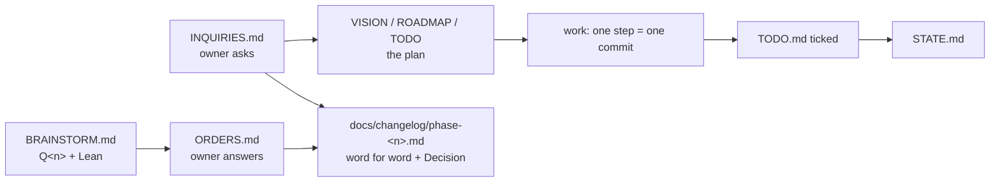

# devlog

The talk between the owner and the agents, and the plan it produces. The
standard look of every BOS project's `docs/devlog/`, taken from how Amoorion
and gitrecon are worked (Amoorion's files, gitrecon's UNIXUSAT naming).
`bos devlog state` reads these files as data: the loop learns from them which
phase is complete and what waits for whom.

| File | What it holds | Who writes it |
| ---- | ------------- | ------------- |
| `VISION.md` | why the project exists, its principles, the idea of each phase | agents, from the owner's words |
| `ROADMAP.md` | milestones and phases on the version scale (semver `vX.Y.Z`, GRIH `vG.R.I.H`) | agents, from the owner's words |
| `TODO.md` | the checklist: `## Phase <n>: <title>`, then `- [ ]` / `- [x]` items | agents tick items in the commit that finishes them |
| `BRAINSTORM.md` | open questions `## Q<n>. <title>`, each with a *Lean:* | agents ask, the owner decides |
| `PROPOSALS.md` | ideas for debate `PP<n>`, in the owner's form (DEFINE, COMBINE, CONCLUDE) | anyone proposes, the owner decides |
| `ORDERS.md` | the owner's answers to `Q<n>`, below its `---` | **owner**; agents empty it |
| `INQUIRIES.md` | the owner's requests in their own words, below its `---` | **owner**; agents empty it |
| `STATE.md` | where the project stands; made by `task devlog:state`, not kept in git | the core |
| `Taskfile.yml` | `state`, `scrapnote` | agents |
| `scrapnote-<UNIXUSAT>.md` | notes of a working round, not sorted yet (`task devlog:scrapnote`) | anyone |
| `AGENTS.md` | imports this README for agents | |

## How a batch moves

1. The owner answers below `---` in ORDERS.md and asks below `---` in
   INQUIRIES.md.
2. An agent first turns an inquiry into the plan (VISION, ROADMAP, TODO).
3. The owner's words move **word for word** into the append-only
   `docs/changelog/phase-<n>.md`, answered questions with their
   **Decision:**; ORDERS.md and INQUIRIES.md go back to their header, and the
   answered `Q<n>` leave BRAINSTORM.md.
4. Then the work, one step per commit, each ticking its TODO item.

Numbers `Q<n>` and `PP<n>` are given once and never reused. A question never
gets settled in code before the owner answers it. Agents' own findings go to
`docs/.agents/`, not here.
